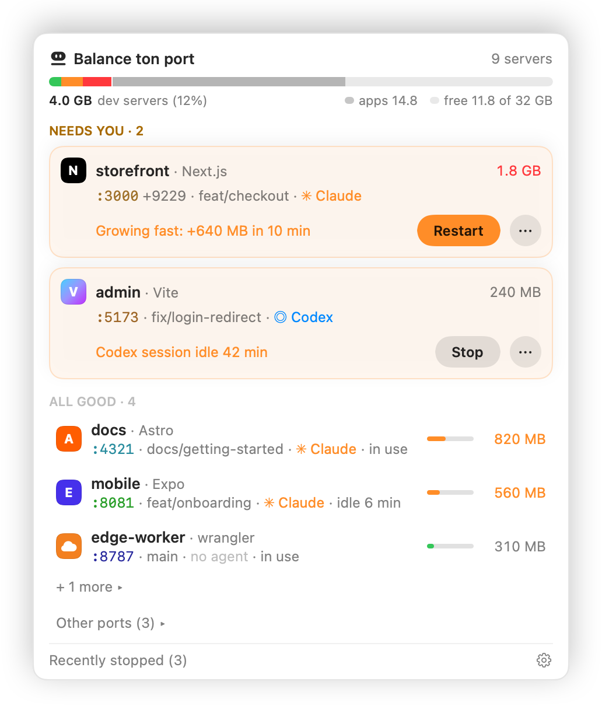
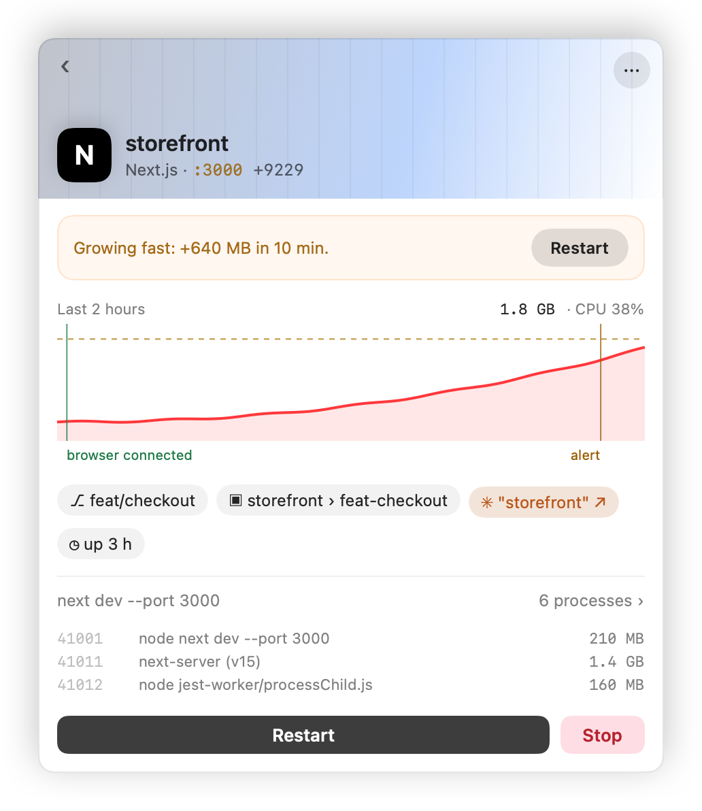

<p align="center">
  
</p>

<h1 align="center">Balance ton port</h1>

Claude Code sessions start dev servers (Astro, wrangler, Metro, Vite, `serve`...) and leave them behind. The session ends or crashes, the worktree is deleted, and the ports stay taken. Balance ton port cleans up automatically and asks only when it cannot be sure.

It is a macOS menu bar app plus a `btp` CLI, both on one Rust core, and an agent skill. Codex CLI sessions are supported too (alerted on port idle only, like a busy Claude Code session; no session-end cleanup); Codex users paste `plugin/skills/balance-ton-port/AGENTS.md` into their repo's `AGENTS.md`.

<p align="center">
  <picture>
    <source media="(prefers-color-scheme: dark)" srcset="docs/screenshots/menu-en-dark.png">
    
  </picture>
  <picture>
    <source media="(prefers-color-scheme: dark)" srcset="docs/screenshots/detail-en-dark.png">
    
  </picture>
</p>
<p align="center">
  <picture>
    <source media="(prefers-color-scheme: dark)" srcset="docs/screenshots/menubar-dark.png">
    
  </picture>
</p>

The screenshots are rendered from made-up servers (`scripts/screenshots.sh`).

## What it does

Every 5 seconds it links new listening servers to the coding-agent session (Claude Code or Codex CLI) that started them, then applies three triggers:

1. **Worktree deleted**: the server is killed at once.
2. **Session dead and port idle for 20 min**: the server is killed.
3. **Session alive but idle for 30 min**: a notification with Kill and Keep buttons (app only).

A server is a process tree: the listening process started under the session plus its children (for example Astro or wrangler with their `workerd` workers). A child listening on its own port is part of its parent's server, and "idle" means no established connection on any port of the whole tree. Kill is SIGTERM on that tree, then SIGKILL after 5 s for survivors; a process of any agent CLI (Claude Code, Codex) found in the tree, or a process matching an excluded command (a `postgres` the dev server started, say), is never signalled, nor is anything it runs. The menu bar lists running servers and the last 5 kills with their reason.

## The menu bar app

- **Needs you**: one card per server that needs a decision (a leak, a session that ended while a browser tab still holds the server, a stop within 10 minutes, the idle alert), each with one suggested action: Restart, Postpone 1 h or Stop. Ignore this alert dismisses the current alert only.
- **Servers**: each row shows the name, the framework, the folder and branch, memory (physical footprint, as in Activity Monitor) and CPU with a health color (green below 500 MB, amber from 500 MB, red on a leak), the agent badge (`Claude`, `Codex` or `no agent`), the status (`in use`, `idle 12 min`, `stops in 8 min`, `kept by you`, `excluded`) and a machine usage bar. The more menu has Open in browser, Restart, Keep, Ignore this alert, Details and Stop.
- **Other servers**: listeners no agent started (a Metro from a plain terminal, a local database, any other server) are shown too, so you can see what holds a port. They are never stopped automatically. Stop and Restart exist only in the app, after a confirmation (Return and Escape cancel); `btp kill`, `btp sweep` and the skill refuse them. System processes, application bundles and the helpers an application starts outside any project folder are not listed (servers run by a framework Python, like Homebrew's, are), and an excluded one has no Stop.
- **Details**: the page title and favicon (fetched over localhost on the server's own port only, never counted as use), a live preview when a browser is already connected to the server, the last 2 hours of memory and CPU with events, the process list, the session (the session chip copies `cd '<folder>' && claude --resume <id>` or `codex resume <id>`, and never opens a terminal), Restart and Postpone 1 h.
- **Postpone 1 h** restarts the countdown for one hour from the click (a deleted worktree still stops at once).
- **Restart** runs the original command again in its folder, with the environment read from the live process at that moment (never stored or logged). The server keeps its session, note, Keep and Postpone. It is refused when the folder is gone, the environment or the command line cannot be read, the port stays taken, an exclusion matches, a restart is already running, or the new process cannot be started (the server then stays stopped). Output goes to `logs/` in the data dir (mode 0600, 20 most recent kept).
- **Leak alerts**: a server above `leak_memory_mb` or growing more than `leak_growth_mb` in 10 minutes raises one notification per leak.

## How it decides

- Only servers linked, at first sight, to a live Claude Code session are tracked; a Claude Code session is recognised by its session file and its process start time.
- Worktree deleted: killed at once. Session dead: killed after 20 min without any established connection on its process tree. Session alive and idle 30 min: an alert, never a silent kill.
- A server whose worktree another live session uses is left alone.
- Excluded commands and ports are re-checked on every scan and right before each kill; excluded children and nested agent CLI processes are spared.
- Every signal is preceded by a start time check, so a reused pid is never hit.

The full design, limitations included, is in [docs/design.md](docs/design.md).

## Install

Menu bar app: download `BalanceTonPort-<version>.dmg` from [GitHub Releases](https://github.com/matthieuh/balance-ton-port/releases), open it and drag Balance ton port to Applications. The image and the app are signed with a Developer ID and notarized. The `btp` CLI is attached to the same release as `btp-<version>-macos-universal.tar.gz`.

Homebrew (macOS; Linux support comes later):

```bash
brew install matthieuh/tap/btp                       # CLI
brew install --cask matthieuh/tap/balance-ton-port   # menu bar app
```

The tap is updated by every final release. The cask is marked `auto_updates`, so the app updates itself and `brew upgrade` leaves it alone.

**Updates.** The app checks for a new version once a day through Sparkle and, by default, downloads and installs it in the background. Settings > About shows the version and build, a Check for Updates button and an Update automatically switch. Updates are signed with an EdDSA key and come from the GitHub release; the feed is `https://github.com/matthieuh/balance-ton-port/releases/latest/download/appcast.xml`. Prereleases are never offered. The CLI does not update itself: use `brew upgrade btp`, or download the new tarball.

**Languages.** The app speaks English, German, French, Spanish, Simplified Chinese, Hebrew (right to left), Japanese and Ukrainian. Settings > General > Language picks one, or System default, and applies at once. The `btp` CLI stays in English. See [LOCALIZATION.md](LOCALIZATION.md) to review or add a language.

From source today (macOS, Xcode, rustup with the aarch64 and x86_64 darwin targets, XcodeGen):

```bash
cargo install --path crates/btp-cli              # the btp CLI

scripts/build-xcframework.sh                     # Rust core + Swift bindings
(cd app && xcodegen generate)
xcodebuild -project app/BalanceTonPort.xcodeproj -scheme BalanceTonPort build
```

## CLI

```bash
btp list [--json]        # tracked servers; --json has "servers" and "recent_kills"
btp kill <port>          # kill a tracked server by port
btp kill --pid <pid>     # ... or by pid
btp sweep [--dry-run]    # apply triggers 1 and 2 once; --dry-run kills nothing
btp watch                # watch in the foreground until Ctrl-C
btp config get           # print the effective configuration
btp config set <key> <n> # set a numeric key
btp recent [--json]      # the last kills
btp note <port> --keep [reason]  # agent intent: spare this server (no alerts), with a reason
btp note <port> --done   # agent intent: stop it once idle after the session ends
btp stale --conversation <id>    # servers of an earlier conversation idle over 5 min (JSON)
btp session-end          # called by the plugin's SessionEnd hook, not by hand
```

Only servers Balance ton port tracks can be killed; an unknown port or pid exits 1. `btp kill <port>` accepts any port of a server's process tree. `btp watch` refuses to start while the app is already watching, and prints each alert once instead of notifying. Without the app, `btp sweep` applies triggers 1 and 2 only (no alerts).

## Configuration

`~/Library/Application Support/balance-ton-port/config.toml`, shared by the app and the CLI. Edit it, use the app's Settings, or `btp config set`.

| Key | Default | Meaning |
|---|---|---|
| `dead_session_idle_s` | 1200 | Idle time before a dead session's server is killed (at least 60) |
| `alert_after_s` | 1800 | Idle time before the Kill / Keep alert (at least 60) |
| `kill_grace_s` | 5 | Delay between SIGTERM and SIGKILL (at least 1) |
| `scan_interval_s` | 5 | Scan period (at least 1) |
| `leak_memory_mb` | 2048 | A server above this much memory (MB) is flagged as a leak (at least 100) |
| `leak_growth_mb` | 500 | A server growing by more than this (MB) in 10 minutes is flagged as a leak (at least 50) |
| `claude_config_dirs` | `[]` | Extra Claude config dirs only. `~/.claude`, `$CLAUDE_CONFIG_DIR` and every `~/.claude-*` with a `sessions/` folder are found automatically |
| `exclude_commands` | `mcp`, `argent`, `postgres`, `redis-server`, `mysqld`, `mongod` | Never tracked or killed when the command line contains one of these (case-insensitive) |
| `exclude_ports` | `[]` | Never tracked or killed when the server, or one of its child processes, listens on one of these ports |

An exclusion matches the whole command line, paths included: a project path containing "mcp" excludes its servers. That errs on the safe side. Exclusions are checked on every scan, not only when a server is first seen: adding one stops tracking a server that matches, it is never killed.

Values below their minimum are refused by `btp config set` and the Settings window, and raised to the minimum when read from the file (with a note on stderr, once per change of the file). If `config.toml` cannot be parsed (one mistyped value is enough), nothing falls back to the defaults silently: a running watcher keeps its last valid settings (a fresh start uses the defaults), the app shows the error in its menu, the CLI prints it, and `btp config get` / `set` refuse to touch the file until it is fixed. Saves are atomic. The app and `btp config set` both write the whole file: the last one to save wins.

## Claude Code plugin

In Claude Code:

```
/plugin marketplace add matthieuh/balance-ton-port
/plugin install balance-ton-port@balance-ton-port
```

What the plugin does: it ships the agent skill, and when a session quits it records the dev servers that session left running. It never stops one at that moment. If you chose "Exit and stop tasks", Claude Code has already stopped its own tasks and there is nothing to record. If you chose "Move to background and exit", the servers were kept on purpose: you get one notification ("Session ended: 2 servers kept running: ... Stopped after 20 min unused, once no session works in that folder"). The background session keeps them while it runs; once it ends, each server is stopped after `dead_session_idle_s` unused, by the app, by `btp watch`, or by a small detached process when neither runs. `/clear` and `/resume` stop nothing: servers left by the earlier conversation and idle more than 5 minutes are offered once, in a single question from Claude.

It needs the `btp` CLI. At the next session start, if `btp` is missing or too old, Claude asks whether to install it; on yes the plugin runs `brew install matthieuh/tap/btp` when Homebrew is present (`BTP_NO_BREW=1` skips it). Otherwise, or if brew fails, it downloads the latest release, checks its sha256 and its Developer ID signature, and installs it to `~/.local/bin/btp` (never with sudo, and it only replaces a `btp` it installed itself). A "no" is remembered; `/balance-ton-port:install` installs it later. To see what the hook found, start Claude Code with `BTP_HOOK_DEBUG=1`: a trace is appended to `session-end.log` in the data dir.

## Agent skill

Teaches agents to run `btp list --json` before starting a server, reuse or free ports with `btp`, note their intent (`btp note <port> --keep "<why>"` or `--done`), and `btp sweep` at the end of a task, instead of `lsof | xargs kill`. The plugin installs it; without the plugin:

```bash
cp -r plugin/skills/balance-ton-port ~/.claude/skills/
```

If you use a custom `CLAUDE_CONFIG_DIR`, copy it into that directory's `skills/` folder instead.

## Safety rules

- Never stops automatically a process that was not started from a live coding-agent session. The app can stop such a server (shown under other servers) only when you ask, one at a time, after a confirmation; `btp kill` and `btp sweep` refuse it.
- A server whose worktree is used by another live session is never touched.
- Agent CLI processes (Claude Code, Codex) themselves are never tracked, and never signalled when found inside a server's process tree.
- A child matching an excluded command (a database started by the dev server) is never signalled when its server is killed.
- Excluded commands and ports are re-checked on every scan and right before each kill.
- Start times are re-checked before every signal, so a reused pid is never hit.
- `btp sweep --dry-run` prints what would be killed.

## Notifications

The idle alert (trigger 3) needs notifications allowed for Balance ton port. The app asks once, at its first launch; if that prompt was dismissed or refused, macOS refuses every later notification without asking again. The app then says "notifications off" on the row of each server due an alert, and keeps the alert pending (it is sent once notifications are allowed). To allow them: System Settings > Notifications > Balance ton port > Allow notifications (Settings also has a button that opens that page). Launch the app from Finder or with `open "Balance ton port.app"`, ideally from `/Applications`, so macOS registers it and lists it there.

## Known limitations

- A Claude Code process that has no session file in a watched config dir (for example a `CLAUDE_CONFIG_DIR` whose `sessions/` folder is shared with another dir, or an older Claude Code) is not watched: the servers it starts are not tracked and never killed. That is the safe direction: nothing is killed, but nothing is cleaned up for that session either.
- A server started in the background (`cmd &`, `nohup`) inside one shell command is reparented to launchd before the first scan and is not tracked.
- Claude Code runs no hook when it crashes or is killed hard: nothing is recorded then, and the normal rules (the app or `btp watch`) apply.

## Releasing

Maintainers: see [RELEASING.md](RELEASING.md) for CI, the signing secrets and how to cut a release.

## License

MIT
